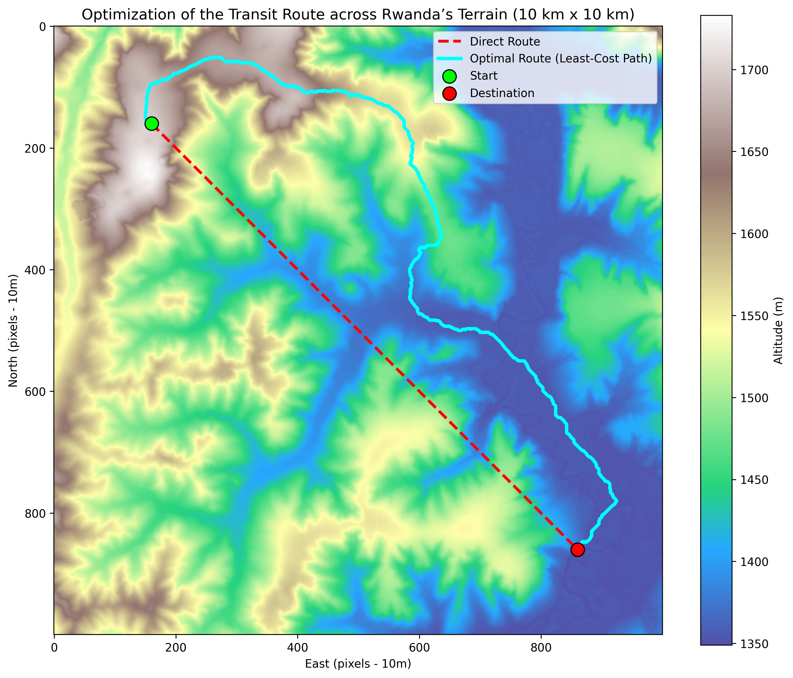

# Rwanda Terrain Navigation - Least-Cost Path Pipeline

A modular geospatial analysis and routing pipeline implemented in Python for complex topography in Rwanda using 10m DEM data.

## Pipeline Architecture
- `01_data_inspection_and_clipping.py`: Windowed extraction of a 10x10 km patch from high-resolution DEM.
- `02_slope_and_cost.py`: Gradient computation, slope percentage extraction, and physical continuous friction surface modeling.
- `03_least_cost_path.py`: 8-neighbor graph representation and Dijkstra shortest-path pathfinding across complex terrain.

## Results

